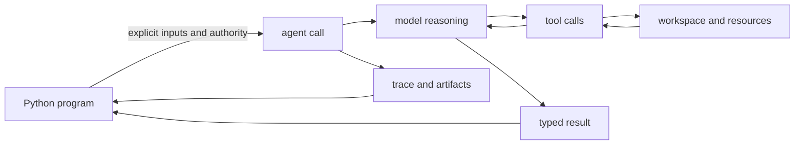
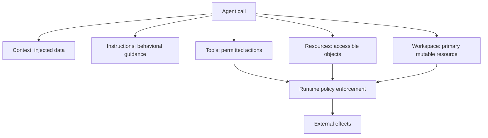
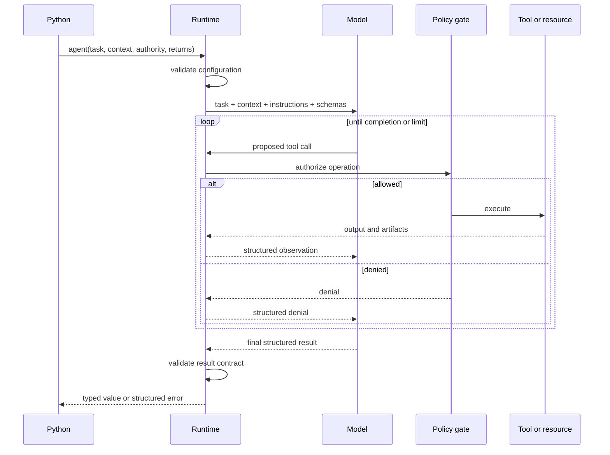
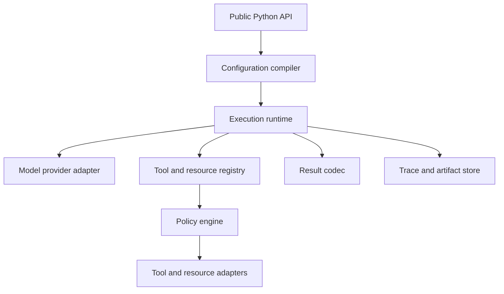

# Pilota

## Design specification for a Python library

**Status:** Draft  
**Working name:** `agentic`  
**Audience:** library users, library implementers, and AI agents implementing the library

---

## 1. Summary

`agentic` embeds autonomous AI work into ordinary Python programs.

The library contributes one central expression:

```python
result = agent(
    "Perform a bounded piece of work",
    context={...},
    resources={...},
    workspace=...,
    instructions=[...],
    tools=[...],
    returns=ResultType,
)
```

An `agent(...)` call may inspect data, use tools, modify an isolated workspace, and return a typed result. Everything around that call remains ordinary Python:

- sequencing;
- branching;
- loops and retries;
- timeouts and cancellation;
- validation;
- memory composition;
- parallel execution;
- error handling;
- persistence;
- business rules.

The library is not a workflow DSL. It makes agent execution a first-class Python expression.

---

## 2. Motivation

Most agent frameworks try to own the whole application. They introduce graphs, declarative workflow formats, built-in retry policies, global memory, and framework-specific control flow.

That is convenient for standard demos but restrictive for programmers:

- orchestration becomes hidden inside the framework;
- retries are difficult to tailor to the situation;
- memory boundaries are implicit;
- agent permissions are broad or unclear;
- intermediate results are weakly typed;
- complex flows require learning a second programming language;
- debugging mixes deterministic application logic with nondeterministic model behavior.

The desired model is the opposite:

> Python owns the process. The agent owns only the bounded work explicitly delegated to it.

This makes nondeterminism local and keeps the surrounding program readable, testable, and controllable.

---

## 3. Design philosophy

### 3.1 Python is the orchestration language

The library must not replace Python control flow.

If the user needs three attempts, a time-bounded loop, exponential backoff, two independent branches, or a custom stopping condition, the user writes those rules directly in Python.

### 3.2 An agent call is an expression

An agent invocation should feel like calling an expensive, effectful function:

```python
plan = agent("Create an implementation plan", returns=Plan)
```

It accepts explicit inputs, performs bounded side effects, and returns a value.

### 3.3 Nondeterminism must have a boundary

The call boundary separates:

- deterministic orchestration outside the call;
- nondeterministic reasoning and tool selection inside the call.

Inputs, permissions, side effects, outputs, and traces must be observable at that boundary.

### 3.4 Authority is explicit

An agent receives no ambient authority.

It can inspect only connected context and resources. It can perform only operations exposed by its tools. It can modify only the configured workspace or writable resources.

### 3.5 Data, instructions, and actions are different concepts

The API must not mix:

- **context**, which is data injected into the model input;
- **resources**, which are external data sources available on demand;
- **instructions**, which describe how work should be performed;
- **tools**, which are actions the agent can invoke;
- **workspace**, which is the primary mutable execution environment.

### 3.6 Typed outputs are contracts, not suggestions

`returns=SomeType` means the call either produces a value conforming to `SomeType` or fails with a structured result-contract error.

The runtime may repair formatting internally, but it must not silently fabricate missing semantic content.

### 3.7 Mechanism, not policy

The library provides mechanisms for execution, isolation, validation, tracing, cancellation, and type conversion.

The user owns policies such as:

- whether to retry;
- how many attempts to make;
- whether to ask another agent to review;
- how to combine memories;
- which failures are acceptable;
- when to escalate to a human.

---

## 4. Non-goals

The core library is not:

- a visual workflow builder;
- a graph DSL;
- a prompt-template framework;
- a mandatory global memory system;
- a built-in multi-agent organization;
- a replacement for Python task queues;
- a provider-specific SDK;
- an autonomous daemon with unrestricted machine access;
- a framework that decides retry or approval policy for the user.

These features may be built on top of the core primitives.

---

## 5. Mental model



The Python program decides **when and why** to delegate. The runtime decides **how** to execute the bounded delegation safely. The model decides **which permitted actions** to take inside that boundary.

---

## 6. Core concepts

| Concept | Meaning | Included in model input automatically | Can cause side effects |
|---|---|---:|---:|
| Task | The work requested from the agent | Yes | No |
| Context | Small immutable values supplied to this call | Yes | No |
| Resource | Named handle to external data inspected on demand | No | Depends on granted operations |
| Workspace | Primary resource where work is performed and artifacts are produced | Metadata only | Usually yes |
| Instruction | Reusable guidance about how to perform work | Yes | No |
| Tool | Callable action available during execution | Schema only | Usually |
| Result contract | Required type and shape of the returned value | Schema/instructions | No |
| Artifact | Durable output produced during execution | No | Already produced |
| Trace | Structured record of execution events | No | No |

### 6.1 Task

The task is the direct instruction for one bounded execution:

```python
agent("Add HTTP response caching and cover it with tests")
```

Tasks should describe outcomes, not orchestration. Orchestration belongs in Python.

### 6.2 Context

Context is immutable call-local data serialized directly into the model input.

Good context values:

- strings and numbers;
- dataclasses or Pydantic models;
- a short project summary;
- a previous typed result;
- validation errors;
- selected configuration;
- a compact memory object.

```python
result = agent(
    "Review the proposed change",
    context={
        "requirements": requirements,
        "diff_summary": diff_summary,
        "risk_budget": "low",
    },
    returns=Review,
)
```

Context has three defining properties:

1. It is eagerly serialized into the call input.
2. It is immutable from the agent's perspective.
3. Its size is expected to be bounded and known by the caller.

Large or lazily inspected data should be a resource instead.

### 6.3 Resources

Resources are named handles to external data or services. Their contents are not automatically placed into the model input.

The agent discovers or reads their contents through explicitly allowed operations.

Examples:

```python
resources={
    "skill_catalog": Directory("./skills", allow={"list", "read"}),
    "docs": KnowledgeBase(client, allow={"search", "get"}),
    "issues": IssueTracker(client, allow={"search", "get"}),
}
```

A resource defines:

- its name and type;
- how it is addressed;
- which operations it supports;
- which operations are allowed for this call;
- optional scope restrictions;
- optional quotas;
- optional secret-backed credentials hidden from the model.

Resources provide both discoverability and an authorization boundary.

### 6.4 Workspace

The workspace is the primary mutable resource for an agent call.

It differs from an auxiliary resource because it defines:

- the default working location for tools;
- where commands execute;
- where files are created or modified;
- where resulting artifacts are collected;
- which state survives between related calls.

```python
repo = Workspace(
    "./my-project",
    allow={"list", "read", "create", "edit", "execute"},
)

change = agent(
    "Implement response caching",
    workspace=repo,
    tools=[Shell(), Editor()],
    returns=Change,
)
```

Conceptually, `workspace` is a resource with a distinguished role. The separate parameter is ergonomic and makes the primary side-effect target obvious.

### 6.5 Instructions

Instructions describe reusable behavior, conventions, or expertise.

Examples:

- a coding style;
- a security checklist;
- a repository-specific workflow;
- instructions for using a framework;
- a skill selected for the current task.

```python
instructions=[
    PythonStyle(),
    SecurityReview(),
    InstructionFile("instructions/project.md"),
    *selected_skills,
]
```

Instructions affect reasoning. They do not directly grant access or executable authority.
Plain strings are literal text and are never interpreted as paths. `InstructionFile` is an
explicit caller-authorized file read, rendered once before the first provider call.

### 6.6 Tools

Tools are callable actions exposed to the agent.

```python
tools=[
    Shell(),
    Editor(),
    Web(),
]
```

A tool defines:

- a name and description;
- an input schema;
- an output schema;
- an implementation;
- side-effect metadata;
- runtime policy checks;
- optional timeout and quota behavior.

The distinction is:

> A resource says what the agent may access. A tool says how the agent may act.

For example, `Editor()` may expose `list`, `read`, `create`, and `edit`, but every operation must be checked against the workspace and resource policies before execution.

### 6.7 Result contract

The `returns` parameter specifies the semantic output contract:

```python
@dataclass
class Change:
    summary: str
    files: list[Path]
    remaining_problems: list[str]


change = agent(
    "Implement response caching",
    returns=Change,
)
```

The runtime validates and converts the model's final response into the requested Python type.

Supported contracts should include:

- primitives;
- dataclasses;
- Pydantic models;
- `TypedDict`;
- lists, dictionaries, unions, and optionals;
- custom adapters through a result-codec protocol.

### 6.8 Artifacts

Artifacts are durable outputs created during execution:

- source files;
- reports;
- images;
- patches;
- generated datasets;
- build outputs;
- recordings.

Artifacts are separate from the typed result. The result may reference artifacts, but the runtime records them independently so they remain observable even if result parsing fails.

### 6.9 Trace

Every call produces a structured trace:

- call started;
- model requested;
- tool proposed;
- policy decision;
- tool started;
- tool completed;
- artifact created;
- result produced;
- validation failed;
- call completed or failed.

Tracing is an execution record, not hidden chain-of-thought. The library must not claim to expose private model reasoning.

---

## 7. Authority model



An operation is allowed only when both conditions hold:

1. A tool exposes the requested action.
2. The target resource permits that action on the addressed object.

This prevents a shell or editor tool from becoming ambient unrestricted access.

Example:

```python
workspace = Workspace(
    "./repo",
    allow={"list", "read", "edit"},
    deny_globs={"**/.env", "**/.git/**"},
)
```

Even if `Editor()` supports file deletion, deletion is unavailable because the workspace does not grant it.

---

## 8. Public API

### 8.1 Minimal synchronous call

```python
summary = agent(
    "Summarize the supplied incident",
    context={"incident": incident},
    returns=str,
)
```

### 8.2 Full call

```python
result = agent(
    task,
    context=context,
    resources=resources,
    workspace=workspace,
    instructions=instructions,
    tools=tools,
    returns=ResultType,
    model=model,
    limits=limits,
    cancel_event=cancel_event,
    metadata=metadata,
)
```

Proposed signature:

```python
def agent(
    task: str | Task,
    *,
    context: Mapping[str, Serializable] | None = None,
    resources: Mapping[str, Resource] | None = None,
    workspace: Workspace | None = None,
    instructions: Sequence[str | Instruction] | None = None,
    tools: Sequence[Tool] | None = None,
    returns: type[T] = str,
    model: Model | None = None,
    limits: Limits | None = None,
    cancel_event: Event | None = None,
    metadata: Mapping[str, str] | None = None,
) -> T:
    ...
```

### 8.3 Detailed execution handle

Most code wants the typed value directly. Code that needs metadata can use `run_agent`:

```python
execution = run_agent(
    "Implement response caching",
    workspace=repo,
    tools=[Shell(), Editor()],
    returns=Change,
)

execution.value
execution.artifacts
execution.trace
execution.usage
execution.status
```

Proposed type:

```python
@dataclass(frozen=True)
class Execution(Generic[T]):
    id: str
    value: T
    artifacts: tuple[Artifact, ...]
    trace: Trace
    usage: Usage
    status: ExecutionStatus
```

`agent(...)` is convenience syntax for `run_agent(...).value`.

### 8.4 Async execution

```python
review = await agent.async_(
    "Review this implementation",
    context={"change": change},
    returns=Review,
)
```

Or:

```python
execution = await run_agent_async(...)
```

The async API must preserve ordinary Python cancellation semantics.

---

## 9. Progressive examples

### 9.1 Structured analysis

```python
@dataclass
class Risk:
    title: str
    severity: Literal["low", "medium", "high"]
    rationale: str


risks = agent(
    "Identify deployment risks",
    context={"change": change_summary},
    returns=list[Risk],
)
```

### 9.2 Selecting skills before execution

```python
@dataclass
class Skill:
    name: str
    content: str
    reason: str


skills = agent(
    "Select the smallest useful set of skills for this task",
    context={
        "task": task,
        "project": project_summary,
    },
    resources={
        "skill_catalog": Directory("./skills", allow={"list", "read"}),
    },
    returns=list[Skill],
)

change = agent(
    task,
    workspace=repo,
    instructions=skills,
    tools=[Shell(), Editor(), Web()],
    returns=Change,
)
```

The first call may inspect the catalog but cannot modify the project. The second call receives the selected skills as instructions and receives explicit authority to work in the repository.

### 9.3 Initial implementation followed by repair

```python
change = agent(
    task,
    workspace=repo,
    context={"project": project_summary},
    instructions=skills,
    tools=[Shell(), Editor(), Web()],
    returns=Change,
)

for attempt in range(3):
    tests = repo.run("pytest")
    problems = validate(change, tests)

    if not problems:
        break

    change = agent(
        "Fix the listed problems in the existing implementation",
        workspace=repo,
        context={
            "original_task": task,
            "previous_result": change,
            "problems": problems,
        },
        instructions=skills,
        tools=[Shell(), Editor(), Web()],
        returns=Change,
    )
else:
    raise UnresolvedProblems(problems)
```

The original task runs once. The loop has a different purpose and a different instruction: repair the current work using explicit feedback.

### 9.4 Time-bounded work

```python
result = agent(
    task,
    workspace=repo,
    tools=[Shell(), Editor()],
    limits=Limits(
        wall_time=timedelta(minutes=5),
        tool_calls=50,
    ),
    cancel_event=cancel_event,
    returns=Change,
)
```

The standard `threading.Event` remains under application control. Wall time and cancellation
are cooperative boundaries checked between provider and tool calls; provider- and tool-specific
timeouts control work already in flight. Neither mechanism implies a retry policy.

### 9.5 Parallel independent work

```python
async with asyncio.TaskGroup() as group:
    backend = group.create_task(
        agent.async_(
            backend_task,
            workspace=backend_workspace,
            tools=[Shell(), Editor()],
            returns=Change,
        )
    )
    frontend = group.create_task(
        agent.async_(
            frontend_task,
            workspace=frontend_workspace,
            tools=[Shell(), Editor(), Web()],
            returns=Change,
        )
    )

backend_change = backend.result()
frontend_change = frontend.result()
```

The library does not invent a parallel-workflow abstraction when Python already has one.

### 9.6 Explicit memory composition

```python
research_memory = Memory(
    facts=research.facts,
    sources=research.sources,
)

implementation_memory = Memory(
    decisions=architecture.decisions,
    constraints=project.constraints,
)

review_context = summarize_memory(  # Application-defined helper
    research_memory,
    implementation_memory,
    budget=8_000,
)

review = agent(
    "Review the implementation",
    context={"memory": review_context},
    resources={"repo": repo.read_only()},
    tools=[Editor.read_only()],
    returns=Review,
)
```

Memory is an application value. The library may provide composition helpers, but it must not silently attach global conversation history.

`Memory` is not a required core primitive. It is only an example of an application-defined typed value passed between calls. Small memory values travel through `context`; a large persistent memory store is connected as a `resource`.

`summarize_memory(...)` is also application-defined in this example. It may use deterministic truncation and selection, or internally call `agent(...)` to produce a semantic summary. The core library does not silently summarize or merge memory.

### 9.7 Reasoning as a reusable value

Explicit analysis does not require a separate execution primitive:

```python
analysis = agent(
    "Analyze the task and compare implementation approaches",
    context={"task": task, "constraints": constraints},
    resources={"docs": docs.read_only()},
    tools=[],
    returns=Analysis,
)

backend = agent(
    backend_task,
    context={"analysis": analysis},
    workspace=backend_repo,
    tools=[Shell(), Editor()],
    returns=Change,
)

frontend = agent(
    frontend_task,
    context={"analysis": analysis},
    workspace=frontend_repo,
    tools=[Shell(), Editor()],
    returns=Change,
)
```

The `analysis` object contains an explicit, inspectable result such as facts, assumptions, alternatives, uncertainties, and a plan. It is not hidden model chain-of-thought.

A convenience helper named `think(...)` may exist, but it must be only shorthand for an `agent(...)` call with no mutating authority and an analysis result contract. It is not a second fundamental abstraction.

---

## 10. Execution lifecycle



### 10.1 Configuration phase

The runtime:

1. validates context serializability;
2. checks names for collisions;
3. builds resource and tool registries;
4. computes effective permissions;
5. compiles the result schema;
6. rejects impossible or unsafe configurations before calling a model.

### 10.2 Agent loop

The runtime repeatedly:

1. requests the next model action;
2. validates the action schema;
3. authorizes it;
4. executes it;
5. records trace events and artifacts;
6. returns a structured observation to the model.

### 10.3 Completion

The runtime:

1. obtains a final result;
2. validates it against `returns`;
3. optionally performs bounded format repair;
4. records usage and final status;
5. returns the typed value or raises a structured exception.

---

## 11. Error model

Errors must distinguish configuration, model, tool, policy, contract, cancellation, and application failures.

```python
class AgentError(Exception): ...

class ConfigurationError(AgentError): ...
class ProviderError(AgentError): ...
class ModelLimitError(AgentError): ...
class ToolError(AgentError): ...
class ToolTimeoutError(ToolError): ...
class PermissionDenied(AgentError): ...
class ResultContractError(AgentError): ...
class ExecutionCancelled(AgentError): ...
```

An exception should carry:

- execution ID;
- failure category;
- safe human-readable message;
- relevant trace reference;
- partial artifacts;
- retryability hint from the mechanism, not an automatic retry decision.

```python
try:
    result = agent(...)
except ToolTimeoutError as error:
    if should_retry_tool_timeout(error):
        ...
```

---

## 12. Limits and budgets

```python
limits = Limits(
    wall_time=timedelta(minutes=10),
    model_calls=30,
    tool_calls=100,
    output_tokens=20_000,
    cost_usd=2.00,
)
```

Limits are hard execution boundaries. They are not retry policies.

The runtime should support:

- wall-clock time;
- model-call count;
- tool-call count;
- token usage;
- monetary cost;
- artifact size;
- per-tool quotas;
- per-resource operation quotas.

---

## 13. Security model

### 13.1 No ambient access

The runtime must not automatically expose:

- the user's home directory;
- environment variables;
- process credentials;
- network access;
- local browser state;
- arbitrary subprocess execution;
- unrelated repositories.

### 13.2 Secret handling

Secrets belong to resource or tool adapters and are never serialized into model-visible context.

```python
issues = IssueTracker(
    endpoint="https://example.invalid",
    credential=SecretRef("ISSUE_TRACKER_TOKEN"),
    allow={"search", "get"},
)
```

The model sees only the tool schema and safe outputs.

### 13.3 Policy enforcement

Authorization is enforced by deterministic runtime code before every side effect.

The model may request a forbidden operation, but it cannot approve its own request.

### 13.4 Sandbox

Workspace implementations may use:

- local directory confinement;
- containers;
- remote virtual machines;
- ephemeral cloud sandboxes;
- version-control worktrees.

The workspace protocol must not assume one isolation technology.

---

## 14. Extensibility

### 14.1 Model provider

```python
class Model(Protocol):
    def respond(self, request: ModelRequest) -> ModelResponse: ...
```

Provider adapters translate the provider-neutral request, tool schemas, and result schema into provider-specific APIs.

### 14.2 Tool

```python
class Tool(Protocol):
    name: str
    description: str
    input_type: type
    output_type: type

    def invoke(self, arguments: object, scope: ExecutionScope) -> object: ...
```

### 14.3 Resource

```python
class Resource(Protocol):
    name: str

    def operations(self) -> Collection[Operation]: ...
    def authorize(self, request: ResourceRequest) -> Decision: ...
    def invoke(self, request: ResourceRequest) -> object: ...
```

### 14.4 Workspace

```python
class Workspace(Resource, Protocol):
    def working_directory(self) -> str: ...
    def snapshot(self) -> WorkspaceSnapshot: ...
    def artifacts_since(self, snapshot: WorkspaceSnapshot) -> list[Artifact]: ...
```

### 14.5 Instruction

```python
class Instruction(Protocol):
    def render(self) -> str: ...
```

The built-in `InstructionFile(path, encoding="utf-8")` implements this protocol. File and
custom instructions are rendered once per execution; render failures raise
`ConfigurationError` before a model call.

Instructions may originate from files, packages, registries, databases, or typed Python objects.

### 14.6 Result codec

```python
class ResultCodec(Protocol, Generic[T]):
    def schema(self) -> JsonSchema: ...
    def decode(self, value: object) -> T: ...
```

---

## 15. Internal architecture



Recommended packages:

```text
agentic/
    __init__.py
    api.py
    execution.py
    models.py
    context.py
    instructions.py
    results.py
    errors.py
    limits.py
    tracing.py
    artifacts.py
    providers/
    tools/
    resources/
    workspaces/
    policies/
```

Core dependencies should remain small. Provider, sandbox, and integration adapters should be optional extras.

---

## 16. Observability

Users must be able to understand what happened without reading hidden model reasoning.

The trace should answer:

- which task ran;
- which inputs and instruction identities were supplied;
- which model and configuration were used;
- which tools were requested;
- which operations were allowed or denied;
- how long each operation took;
- which artifacts changed;
- which result validation failed;
- what the final usage and cost were.

Sensitive values must be redacted at their source.

Hooks:

```python
execution = run_agent(
    task,
    observers=[
        ConsoleObserver(),
        JsonLinesObserver("trace.jsonl"),
        OpenTelemetryObserver(),
    ],
)
```

---

## 17. Deterministic testing

The orchestration layer should be testable without a real model.

```python
model = ScriptedModel([
    ToolCall("editor.read", {"path": "app.py"}),
    ToolCall("editor.edit", {"path": "app.py", "patch": "..."}),
    FinalResult({"summary": "Added cache", "files": ["app.py"]}),
])

result = agent(
    task,
    model=model,
    workspace=InMemoryWorkspace(...),
    tools=[Editor()],
    returns=Change,
)

assert result.files == [Path("app.py")]
```

The library should provide:

- scripted model responses;
- in-memory resources;
- in-memory workspaces;
- deterministic tool doubles;
- trace assertions;
- permission-denial assertions;
- result-contract fixtures.

---

## 18. MVP scope

### 18.1 Required

1. Synchronous `agent(...)` and detailed `run_agent(...)`.
2. One model-provider adapter.
3. Dataclass and Pydantic result contracts.
4. Context serialization.
5. Resource and workspace protocols.
6. Directory workspace with explicit permissions.
7. Shell and editor tools constrained to the workspace.
8. Instructions loaded from strings and files.
9. Structured errors.
10. Limits for wall time, model calls, and tool calls.
11. Structured trace and artifact collection.
12. Scripted model and in-memory test utilities.

### 18.2 Deferred

- distributed execution;
- remote durable queues;
- visual workflow editor;
- global memory service;
- built-in agent teams;
- automatic skill selection;
- automatic retry policy;
- marketplace or registry;
- provider routing and optimization;
- human approval UI.

These should be implementable as libraries or services using the core API.

---

## 19. MVP acceptance criteria

An implementation is ready when all of the following are true:

1. A user can delegate a file-changing task with fewer than fifteen lines of orchestration code.
2. The agent cannot read or write outside its workspace.
3. Tool calls are denied when either the tool or resource policy forbids the operation.
4. A dataclass result is returned as a real typed Python object.
5. Invalid final output raises `ResultContractError`.
6. Cancellation stops further model and tool calls.
7. Every tool call and artifact is represented in the trace.
8. Secrets held by adapters never appear in model input or trace output.
9. The same orchestration can be unit-tested with a scripted model.
10. Retry and repair behavior can be expressed entirely with ordinary Python.

---

## 20. Terminology decisions

Recommended terms:

| Term | Decision |
|---|---|
| `agent(...)` | The main expression because it describes delegated autonomous work |
| `context` | Eager immutable call input |
| `resources` | Lazily accessed external objects |
| `workspace` | Primary mutable resource |
| `instructions` | Behavioral guidance and selected skills |
| `tools` | Callable actions |
| `returns` | Typed result contract |
| `Execution` | Detailed envelope containing value, trace, artifacts, and usage |

Avoid using `capabilities` in the initial public API because it ambiguously combines tools, permissions, resources, and instructions.

---

## 21. Open design decisions

The following decisions should be resolved before implementation:

1. Should the public call be named `agent`, `perform`, `delegate`, or `run`?
2. Should `agent(...)` block by default, or should the primary API be async?
3. Should `workspace` accept only one resource or support named mounted workspaces?
4. Should resource operations automatically appear as model tools, or only through explicit tool adapters?
5. How much result-format repair is allowed before raising `ResultContractError`?
6. Should instructions be plain rendered text or structured sections with precedence rules?
7. What trace format is stable enough to become a compatibility contract?
8. Which sandbox is the reference implementation for shell execution?

The MVP should resolve these explicitly rather than leaving them as accidental implementation details.

---

## 22. Implementation brief for an AI coding agent

An implementation agent should:

1. Build the provider-neutral domain model and protocols first.
2. Implement a deterministic scripted provider and in-memory workspace.
3. Test policy enforcement before adding real model access.
4. Implement typed result conversion and errors.
5. Add tracing and artifacts.
6. Add one real provider adapter.
7. Add the directory workspace, editor, and constrained shell.
8. Recreate the examples in this document as integration tests.

The implementation must preserve the central invariant:

> The library executes one bounded autonomous operation; the surrounding Python program remains in control.
